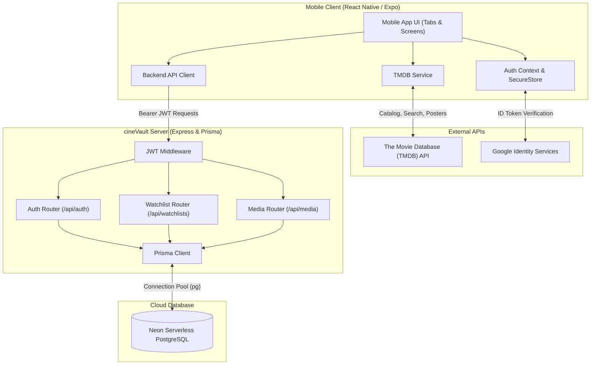

# cineVault

cineVault is a cross-platform movie and television tracking application featuring a dark, cinematic user experience. Built with React Native, Expo, Node.js, Express, Prisma, and PostgreSQL, cineVault provides film and television enthusiasts with a unified hub to explore titles, curate personalized watchlists, and maintain a comprehensive personal viewing history.

> **Important:** cineVault is an organization and tracking application, **not a streaming service or content host**. It connects users to rich catalog metadata and provides personal library tracking, but does not host, stream, or pirate media content.

---

## The Core Concept

```text
Discover ───► Save ───► Watch ───► Track
```

- **Discover:** Explore trending titles, popular releases, and upcoming cinema powered by TMDB metadata.
- **Save:** Organize films and series into default and custom thematic watchlists (e.g., *Sci-Fi Favorites*, *Anime Backlog*, *Weekend Binge*).
- **Watch:** Enjoy entertainment on authorized streaming platforms, theaters, or home media.
- **Track:** Record watched status globally across your account, monitor viewing statistics, and review your personal history.

---

## Features

### Authentication & Account Management
- **Google Sign-In:** Secure OAuth 2.0 authentication powered by Google Identity Services and native mobile credentials.
- **JWT Session Management:** Robust JSON Web Token authorization with automatic session persistence using `expo-secure-store`.
- **User Scoping:** Strict isolation ensuring user watchlists, media tracking records, and viewing histories are private and secure.

### Watchlist Management
- **Default Watchlist:** Every user is automatically provisioned a permanent `My Watchlist` upon account creation.
- **Custom Watchlists:** Create unlimited custom thematic watchlists with personalized names (case-insensitive name uniqueness enforced per user).
- **List Maintenance:** Rename or delete custom watchlists. Built-in protection prevents renaming or deleting the default watchlist.
- **Multi-List Membership:** Save the exact same movie or TV show across multiple watchlists simultaneously.
- **Duplicate Prevention:** Strict database-level uniqueness prevents adding duplicate titles within the same watchlist.
- **Cascading Membership:** Removing a title from one list does not affect its presence in other watchlists or its global watched status.

### Viewing Status & History
- **Global Watched State:** Watched status is tracked at the user-media level. A title remains marked as watched regardless of which watchlists it belongs to—even if it belongs to zero watchlists.
- **Chronological History:** Paginated viewing history tracking when titles were completed.
- **Unmarking Capability:** Easily toggle watched titles back to planning status (`WANT_TO_WATCH`).
- **Unreleased Movie Guard:** Prevents newly marking unreleased movies as watched based on real-calendar release dates and TMDB production status (`Planned`, `In Production`, `Post Production`, `Rumored`). Titles already marked as watched can always be unmarked.

### Media Discovery & Detail Views
- **Rich Metadata:** Live movie and TV show data fetched from The Movie Database (TMDB) API, including overviews, ratings, genres, runtimes, and season/episode lists.
- **YouTube Trailers:** Direct in-app launching of official trailers and teasers.
- **Fast Search & Filtering:** Filter searches by movies, TV series, or unified catalog queries.

### Profile & Dynamic Statistics
- **Live User Profile:** Displays user identity, email, and Google profile avatar.
- **Watched Counter:** Accurate count of all globally completed titles sourced from viewing history.
- **Deduplicated Watchlist Counter:** Displays the number of *distinct* titles saved across all user watchlists (a title appearing in three lists counts exactly once).
- **Pull-to-Refresh & Focus Sync:** Automatic background updates on screen focus and manual pull-to-refresh.

---

## Technology Stack

| Layer | Technology | Purpose |
|---|---|---|
| **Mobile Client** | React Native `0.88.1` / Expo `~58.0.26` | Cross-platform native mobile application (Android development build / iOS) |
| **Language** | TypeScript `~6.0.3` (Mobile) / `^5.7.3` (Server) | End-to-end type safety and contract enforcement |
| **Navigation** | React Navigation `^7.x` | Native stack navigation and bottom tab routing |
| **Local Storage** | Expo SecureStore `~58.0.3` | Encrypted keychain/keystore token storage |
| **Backend API** | Node.js `24.x` / Express `^4.21.2` | RESTful API server handling business logic and authorization |
| **Database** | PostgreSQL | Relational storage hosted on Neon serverless PostgreSQL |
| **ORM** | Prisma ORM `^6.19.3` | Type-safe database queries, schema migrations, and connection pooling |
| **Authentication** | Google Auth Library / `jsonwebtoken` | Token verification and stateless JWT issuance |
| **Metadata Provider**| TMDB API (`api.themoviedb.org/3`) | Movie, TV show, season, episode, and trailer metadata |
| **Web Client** | Next.js `16.4.6` / React `19.3.0` | Initial web client scaffold (planned companion platform) |

---

## Architecture

cineVault utilizes a decoupled client-server architecture. Catalog discovery requests are handled directly by the mobile client via TMDB, while personal library actions, watchlists, authentication, and viewing statuses are managed by the Express backend.



### Architecture Notes
- **Metadata Snapshots:** When a user adds a title to a watchlist or marks it as watched, the mobile client submits a normalized metadata snapshot (`title`, `posterPath`, `releaseDate`, `voteAverage`, `overview`) to the backend. This enables offline access and instant viewing history rendering without repetitive TMDB lookups.
- **Client Monorepo Status:** The repository contains an active `mobile/` React Native application, an active `server/` Express backend, and a starter `client/` Next.js 16 web application scaffold reserved for future web expansion.

---

## Project Structure

```text
cineVault/
├── mobile/                   # React Native / Expo mobile application
│   ├── assets/               # Application icons, splash screens, and images
│   ├── services/             # TMDB API client and image resolution helpers
│   ├── src/
│   │   ├── context/          # React contexts (AuthContext session management)
│   │   ├── navigation/       # Root stack and bottom tab navigators
│   │   ├── screens/          # Main views (Home, Search, Details, Watchlist, Profile)
│   │   └── services/         # Authenticated backend API client (api.ts)
│   ├── types/                # TMDB and CineVault API TypeScript interfaces
│   ├── app.json              # Expo application configuration
│   └── package.json
│
├── server/                   # Express REST API backend
│   ├── prisma/
│   │   ├── migrations/       # SQL schema migrations (Neon PostgreSQL)
│   │   └── schema.prisma     # Prisma data models, relations, and indexes
│   ├── src/
│   │   ├── controllers/      # Request handlers (auth, watchlist, media)
│   │   ├── middleware/       # JWT authentication and request validation
│   │   ├── routes/           # Express router endpoints (/api/auth, /api/watchlists, /api/media)
│   │   ├── services/         # Database business logic and concurrency locking
│   │   ├── utils/            # Strict payload validation utilities
│   │   └── index.ts          # Server entry point and middleware configuration
│   ├── tests/                # Automated Node test runner suites (149+ unit & integration tests)
│   └── package.json
│
├── client/                   # Next.js web application scaffold (Tailwind CSS, Turbopack)
│   ├── app/                  # Next.js app router structure
│   └── package.json
│
└── README.md                 # Project documentation
```

---

## Local Development Setup

### Prerequisites
- **Node.js:** `v20.x` or `v24.x` LTS
- **Package Manager:** `npm` (v10+)
- **Git**
- **Mobile Development Tools:**
  - Android Studio with Android SDK / Emulator, or an Android device with Expo Go / development build installed.
  - Optional: Xcode (macOS only) for iOS development.

---

### 1. Repository Setup

Clone the repository and enter the project directory:

```bash
git clone https://github.com/Kinshu15/cineVault.git
cd cineVault
```

---

### 2. Backend Setup & Configuration

Navigate to the `server` directory and install dependencies:

```bash
cd server
npm install
```

Create an environment configuration file:

```bash
cp .env.example .env
```

Configure the following environment variables in `server/.env`:

| Variable | Description |
|---|---|
| `PORT` | Local server port (default: `5001`) |
| `NODE_ENV` | Environment mode (`development` or `production`) |
| `DATABASE_URL` | Pooled Neon PostgreSQL connection URL |
| `DIRECT_URL` | Direct Neon PostgreSQL connection URL (for Prisma migrations) |
| `GOOGLE_CLIENT_ID` | Google OAuth 2.0 Web Client ID |
| `JWT_SECRET` | 256-bit secret key used to sign session JWTs |
| `JWT_EXPIRES_IN` | Token expiration duration (e.g., `7d`) |

Run database migrations to initialize tables and indexes:

```bash
npx prisma migrate dev
```

Start the backend server in development mode:

```bash
npm run dev
```

The backend server will start at `http://localhost:5001`. A health check endpoint is accessible at `http://localhost:5001/api/health`.

---

### 3. Mobile Client Setup & Configuration

Open a new terminal window, navigate to the `mobile` directory, and install dependencies:

```bash
cd mobile
npm install
```

Create a mobile environment configuration file:

```bash
touch .env
```

Configure the required variables in `mobile/.env`:

| Variable | Description |
|---|---|
| `EXPO_PUBLIC_API_URL` | Backend URL (e.g., `http://YOUR_LOCAL_IP:5001` for physical device or `http://localhost:5001` for emulator) |
| `EXPO_PUBLIC_GOOGLE_WEB_CLIENT_ID` | Matching Google OAuth Web Client ID for authentication |
| `EXPO_PUBLIC_TMDB_API_KEY` | TMDB API v3 Developer Key |

Start the Expo bundler:

```bash
npx expo start
```

Press `a` in the terminal to open the application in an Android emulator, or scan the QR code using the Expo Go / development client app on an Android device connected to the same Wi-Fi network.

---

## Backend API Overview

All `/api/watchlists` and `/api/media` routes require an `Authorization: Bearer <token>` header obtained from `/api/auth/google`.

### Authentication Endpoints
- `POST /api/auth/google` — Authenticate via Google ID token; returns session JWT and user profile.
- `GET /api/auth/me` — Retrieve the current authenticated user's profile.

### Watchlist Management
- `GET /api/watchlists` — Retrieve all watchlists for the user alongside `distinctItemCount`.
- `POST /api/watchlists` — Create a new custom watchlist (`name`).
- `PATCH /api/watchlists/:id` — Rename an existing custom watchlist (`name`).
- `DELETE /api/watchlists/:id` — Delete a custom watchlist (cascades list items; default list protected).
- `GET /api/watchlists/:id/items` — Paginated list of media items in a specific watchlist (`?page=1&limit=20`).

### Watchlist Items & Tracking
- `POST /api/watchlists/:id/items` — Add a movie or TV show to a watchlist with metadata.
- `DELETE /api/watchlists/:id/items/:userMediaId` — Remove a title from a watchlist.
- `GET /api/media/:mediaType/:tmdbId` — Check user tracking status, watched state, and watchlist memberships for a title.
- `POST /api/media/status` — Upsert media status directly (`status: 'WATCHED' | 'WANT_TO_WATCH'`).
- `PATCH /api/media/:id/status` — Update tracking status by `UserMedia` ID.
- `GET /api/media/history` — Paginated viewing history of completed titles.

---

## Verification & Testing

The backend includes a comprehensive automated test suite covering input validation, concurrency locking, cascading deletions, route authentication, and aggregation correctness:

```bash
cd server
NODE_ENV=test node --import tsx --test tests/validation.test.ts tests/media-service.test.ts tests/media.routes.test.ts tests/watchlist.test.ts tests/watchlist.routes.test.ts
```

To run TypeScript verification across workspaces:

```bash
# Mobile client type check
cd mobile && npx tsc --noEmit

# Backend type check
cd server && npm run build
```

---

## Development Status & Roadmap

### Current Status (Phase 2 Completed)
- [x] Google Sign-In & JWT Session Engine
- [x] Default & Custom Thematic Watchlists
- [x] Global Watched Status & Viewing History Tracking
- [x] Unreleased Movie Watched-Action Restriction
- [x] TMDB Movie & TV Show Browsing, Search, and Trailers
- [x] Deduplicated Watchlist & Global Watched Statistics
- [x] Resilient Offline/Error State Management & Stale-Request Protection

### Planned Future Enhancements
- [ ] **Personalized Recommendations:** Recommendation engine based on viewing history and saved watchlists.
- [ ] **Social Features:** Collaborative watchlists shared between users.
- [ ] **Community & Friends:** Friend activity feeds and social profiles.
- [ ] **Custom Lists Sharing:** Public URLs and exportable lists.
- [ ] **Web Client Expansion:** Full Next.js client integration using the shared backend API.
- [ ] **Production Android Release:** Standalone APK & Google Play Store release.
